<div align="center">


# VAPP - die Versammlungs-App

**Alles, was eine Versammlung braucht**

Zusammenkünfte, Predigtdienst, Trolley, Saal und Berichte — geplant in einer Anwendung, die auf
eurem eigenen Server liegt.


[](https://demo.rbnet.me)

### [▶ Live-Demo ausprobieren — ohne Konto, ohne Anmeldung](https://demo.rbnet.me)

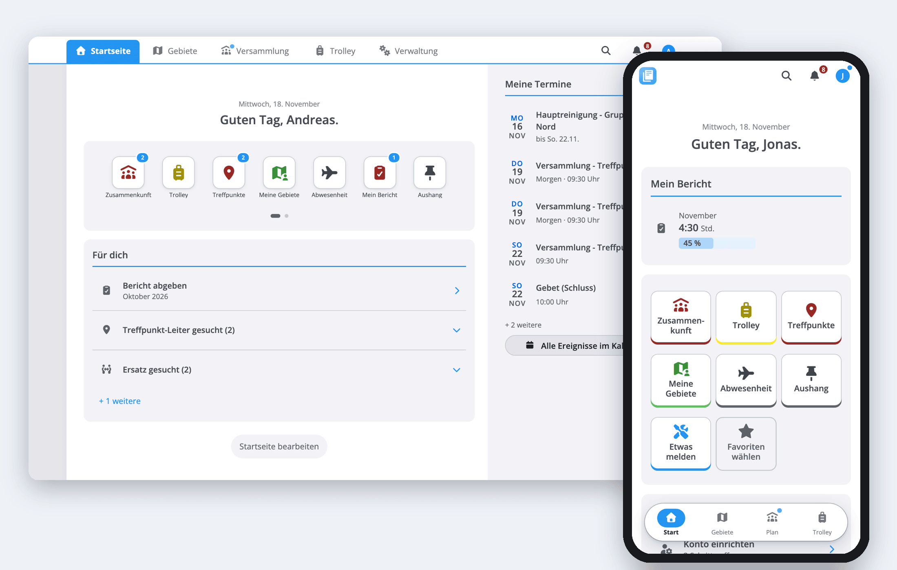

</div>

## Auf einen Blick

**VAPP ist die zentrale Anlaufstelle einer Versammlung.** Wer plant, plant hier — Zusammenkünfte,
Gebiete, Trolley, Saal und Berichte. Wer eingeplant ist, sieht hier, was ansteht — auf dem Handy,
auch ohne Netz. Statt Zetteln, Aushängen und verteilten Tabellen gibt es einen Stand, digital und
immer aktuell. Und er gehört der Versammlung: VAPP läuft auf eurem eigenen Server und nirgendwo sonst.

- 🗓️ **Zusammenkünfte in Minuten** — Arbeitsheft und Wachtturm als ePub einlesen, Aufgaben mit
  vorsortierten Vorschlägen besetzen, Ersatz im Gespräch finden.
- 🙋 **Jeder weiß, was ansteht** — „Für dich“ zeigt, was jetzt zu tun ist; „Meine“ zeigt die
  eigenen Aufgaben über alle Pläne.
- 🗺️ **Gebiete digital** — Grenzen auf der Karte zeichnen, zuteilen oder selbst übernehmen, per
  QR-Code teilen, Karte als PDF.
- 🛒 **Trolley zum Selberbuchen** — Routen, Schichten, Bestückung, Team und Statistik.
- 📊 **Predigtdienstbericht in der App** — Notizbuch führen, abgeben, erinnern, nachtragen; der
  Sekretär hat die Zahlen für jw.org fertig. Verschlüsselt und nach kurzer Zeit gelöscht.
- 🏛️ **Saal im Griff** — Reinigung, Müllkalender, Raumbelegung, Instandhaltung mit Arbeitsblättern
  und Mängelmeldung per Foto.
- 📶 **Unterwegs auch offline** — Plan, eigene Gebiete samt Karte, Trolley und Kalender liegen auf
  dem Gerät, bevor der Empfang weg ist.
- 🔐 **Eure Daten, euer Server** — Anmeldung per Passkey, Rechte aus Status und Aufgaben, Sicherung
  per Knopfdruck, kein Dienst dazwischen.

> **English:** VAPP is a self-hosted **congregation management app for Jehovah's Witnesses** —
> Life and Ministry meeting scheduler with EPUB workbook and Watchtower import, weekend meeting,
> public talk and attendant schedules, substitute requests, territory maps with self check-out,
> public witnessing cart scheduling, field service groups, monthly field service reports, cleaning,
> maintenance and Kingdom Hall schedules with defect tickets. Installable PWA with offline mode,
> push notifications, calendar feeds and passkey login. The interface ships in five languages,
> among them German, English, Greek and Russian; this page and the setup guide are German. Try the
> **[live demo](https://demo.rbnet.me)** without an account. Docker images
> `ghcr.io/rbnet-apps/vapp-app` and `…/vapp-web` for `linux/amd64` and `linux/arm64`. Not an
> official tool of the organization.

## Live-Demo

Auf **[demo.rbnet.me](https://demo.rbnet.me)** steht eine erfundene Versammlung, die sich alle
Besucher teilen — ohne Konto und ohne Anmeldung.

- **Zwei Rollen zum Wechseln:** Oben über „Testmodus“ wechselst du zwischen **Verwalter** und
  **Verkündiger**.
- **Alles ausprobieren:** Zusammenkünfte und Predigtdienst planen, Trolley-Schichten eintragen,
  Gebiete anfordern, den Bericht abgeben, Abwesenheit eintragen, Tickets melden, den Aushang lesen.
- **Regelmäßig frisch:** Die Daten werden regelmäßig zurückgesetzt; wann, zeigt die
  Testanlage oben. Passwort, Einladungen, Uploads, Mail und Push sind gesperrt.

## In zwanzig Minuten ist die Versammlung erstellt

Kein Konto bei irgendwem, keine Anmeldung, kein Vertrag. Ein Rechner mit Docker, ein Befehl, der die
Dateien holt, ein Einrichtungsskript, das alles Benötigte abfragt und **jeden Schlüssel selbst
erzeugt** — danach führt ein Assistent Schritt für Schritt durch die Ersteinrichtung: Versammlung,
Zusammenkunftszeiten, Personen und Gruppen, Bereiche, Helfer und Zugänge. Niemand muss vorher
wissen, wie Docker oder eine Datenbank funktioniert.

## Für wen

- **Selbstverwaltung, Datenhoheit.** Eine Versammlung, die ihre Planung selbst in der Hand behalten will.
- **Planer**: Koordinator, Sekretär, Dienstaufseher, Leben-und-Dienst-Aufseher, Gebietsdiener,
  Vortragsplaner, Trolley-Koordinator, Instandhaltung.
- **Alle anderen**, die schauen, wann sie eingeplant sind, ihr Gebiet bearbeiten, Trolleydienst
  eintragen oder ihren Bericht abgeben — als WebApp installiert, mit Benachrichtigung und
  Kalender-Abo.

**Wofür nicht:** VAPP ist **kein offizielles Werkzeug der Organisation** und ersetzt keins.

## Alternativen

Wer schon eine Versammlungs-App wie **NW Scheduler / NW Publisher**, **Hourglass**, **TheocBase**,
**Organized** oder **Meeting Schedule Assistant** kennt: VAPP deckt dieselben Aufgaben ab —
Zusammenkünfte, Gebiete, Trolley, Berichte — und dazu Saal und Instandhaltung, in **einer**
Anwendung. Der Unterschied: sie läuft **auf eurem eigenen Server**, nicht auf einem einzelnen PC
und nicht bei einem fremden Anbieter.

## Was die VAPP kann — entlang der Abläufe einer Versammlung

### 🗓️ Zusammenkünfte vorbereiten

Vom Arbeitsheft bis zum Aushang: der Ablauf, den der Leben-und-Dienst-Aufseher, der Vortragsplaner
und der Ordnungsdienst jede Woche durchlaufen.

**Arbeitsheft und Wachtturm einlesen**

- Das ePub wird eingelesen und legt die Zusammenkünfte an — Lieder, Themen und Programmteile
  inklusive. Es bleibt nur noch, die Aufgaben zu besetzen.
- Liegt eine neue Zusammenkunft in einem belegten Raum, warnt der Import.

**Aufgaben besetzen mit vorsortierten Vorschlägen**

- Oben steht, wer lange nicht dran war und für diese Aufgabe freigegeben ist. Jede Person zeigt
  ihren letzten und nächsten Einsatz in Wochen.
- Wer abwesend ist oder schon zu viel hat, ist markiert. Auf Wunsch stehen alle für alle Aufgaben
  zur Wahl.
- Der Ordnungsdienst lässt sich automatisch planen — nach Verfügbarkeit und Häufigkeit der letzten
  Dienste.

<p align="center">
  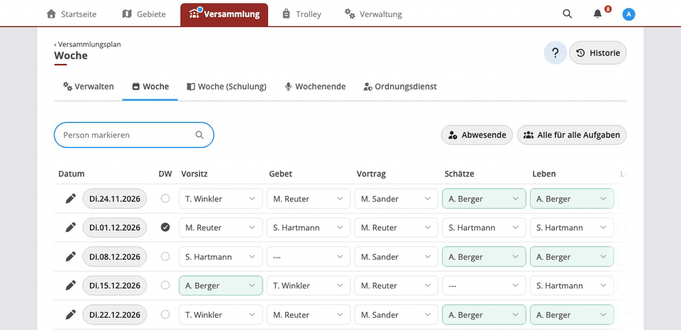
</p>

**Öffentliche Vorträge und Gastredner**

- Eingehende und auswärtige Redner an einem Ort. Jeder, der den Plan sieht, liest die kommenden
  Gastredner als Liste.
- Je Termin hält der Vortragsplaner fest, ob der Gastredner einen Gastgeber sucht und ob einer
  gefunden ist.

**Dienstwoche des Kreisaufsehers**

- Ein Eintrag im Plan genügt: die App markiert jede Zusammenkunft der Woche und erstellt das
  Programm als Seite, als Heft zum Drucken und als Knopf auf der Startseite.

**Zähldienst, Aushang, Ausdrucke**

- Der zuständige Dienst wird ans Zählen der Anwesenden erinnert, bis alle Zahlen erfasst sind.
- Alle PDFs in einem Stil: durchsuchbar, schwarz-weiß-tauglich, mit Versammlung und Stand im Kopf —
  der Versammlungsplan eine Woche je Blatt.
- Die Aufgabenübersicht passt auf eine Seite: wer welche Aufgabe hat und wofür man ihn anspricht.

<p align="center">
  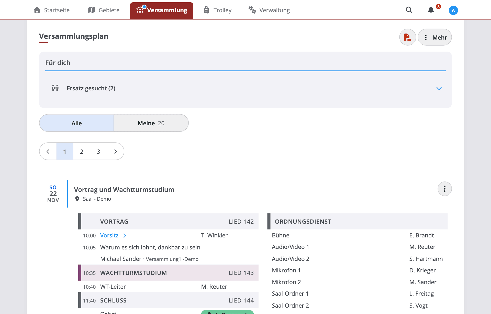
</p>

### 🙋 Eingeplant sein — für jeden in der Versammlung

Wer eine Aufgabe hat, muss nicht suchen: die App sagt es ihm.

**„Für dich“ und „Meine“**

- „Für dich“ zeigt nur, was du jetzt tun musst — Bericht abgeben, Ersatz gesucht, Treffpunkt
  übernehmen. Eine Zeile nach links wischen stellt sie auf morgen, eine Woche oder die nächste
  Zusammenkunft zurück.
- „Meine“ zeigt über dem Plan alle eigenen Aufgaben nach Datum. Ein Abend, an dem du abwesend bist,
  ist orange markiert.

**Ersatz finden im Gespräch**

- Wer verhindert ist, fragt gezielt nach Ersatz. Nachrichten und Verlauf stehen an einem Ort, die
  Planer lesen mit.
- Ist der Ersatz übernommen, danken Fragender und Planer mit eigenen Worten.

**Termine, Abwesenheit, Erinnerungen**

- „Meine Termine“ sammelt alles im Kalender; das **Kalender-Abo** bringt es in die Kalender-App
  von Handy oder Computer.
- Abwesenheit einmal eintragen — die Planung berücksichtigt sie sofort.
- Private Termine und Erinnerungen, auch wiederkehrend oder vor der Zusammenkunft; das Telefon
  erinnert, wann du willst.

<p align="center">
  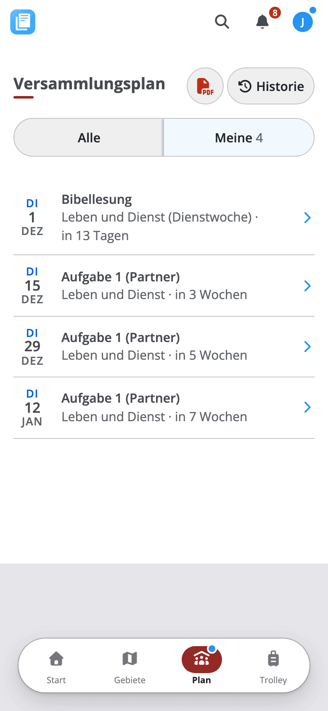
  &nbsp;
  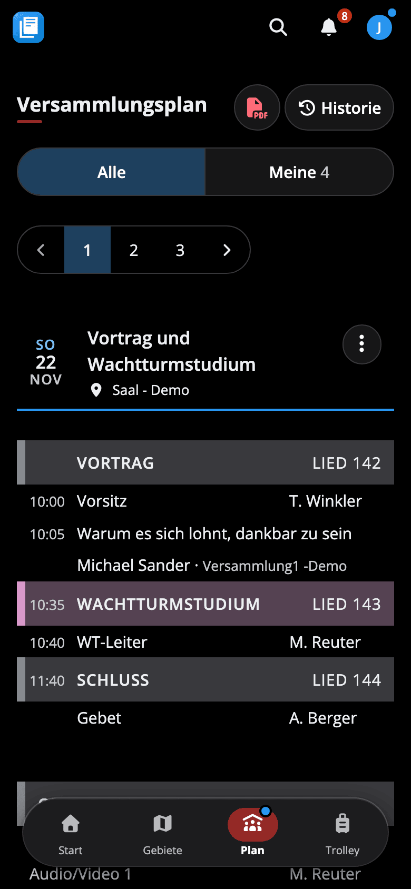
</p>

### 🗺️ Predigtdienst

**Gebiete**

- Gebietsgrenzen werden im Kartenwerkzeug gezeichnet — kein Grafikprogramm nötig. Als
  Online-Ansicht oder als Gebietskarte im PDF.
- Kartenanbieter wählbar: OpenStreetMap (weltweit) oder Bundesamt für Kartographie und Geodäsie
  (Deutschland).
- „Meine“, „Freie“ und „Alle“ auf einen Blick. Verkündiger nehmen sich ein freies Gebiet selbst und
  geben es zurück, auch unfertig — wenn der Gebietsdiener das einschaltet.
- Ein Gebiet per QR-Code zeitweise mit der Gruppe teilen. Optional zeigt die Karte den eigenen
  Standort.
- Dienstwochen als Ganzes planen: verfügbare Gebiete, Ausdrucke und Übersichtskarte in einer Ansicht.

**Treffpunkte**

- Treffpunkte im Kalender, mit PDF zum Aushängen.
- „Treffpunkt-Leiter gesucht“: offene Treffpunkte der nächsten 14 Tage stehen unter „Für dich“;
  wer zuerst „Ich übernehme“ tippt, leitet.

**Predigtdienstgruppen**

- „Meine“ zeigt die eigene Gruppe mit Abhakliste, „Alle“ jede Gruppe. Die Gruppeneinteilung wird
  gedruckt und lässt sich direkt bearbeiten.
- Auch Namen ohne eigenes Konto, etwa Kinder, stehen in der Gruppe.

**Literaturangebot**

- Der Literaturdiener legt je Monat fest, welche Schriften die Versammlung anbietet — als Plakat im
  Aushang und als erste Auswahl am Trolley.

<p align="center">
  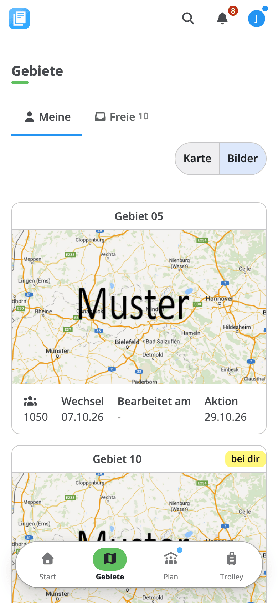
  &nbsp;
  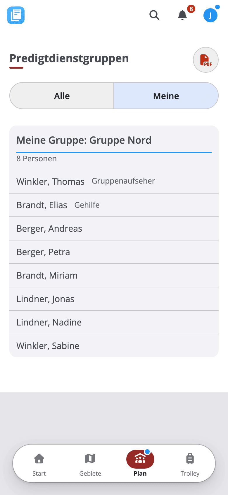
</p>

### 🛒 Trolley

**Selbst buchen**

- Schichten und Zeiten werden einmal eingerichtet und laufen danach von selbst weiter.
- Wer freigegeben ist, bucht seine Schicht selbst. „Meine“ zeigt nur die eigenen Schichten und mit
  wem du vorher und danach eingeteilt bist; jeder Tag klappt auf und zeigt freie Plätze.

<p align="center">
  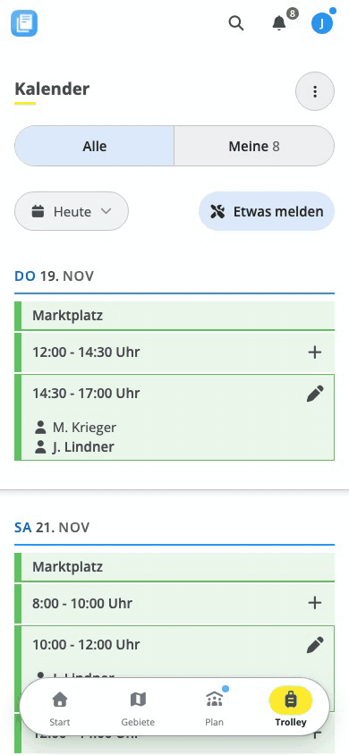
  &nbsp;
  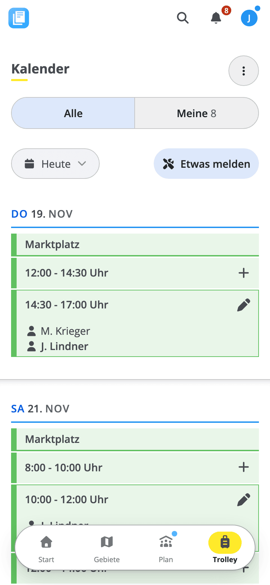
</p>

**Bestückung und Team**

- Beim Wechsel zeigt der Dialog den Trolley als Zeichnung, bietet die letzten Bestückungen als
  Vorlage an und listet Plakate und Schriften mit Bild — Plakate je Sprache.
- Das Trolley-Team verwaltet Routen und Ausrüstung, zwei Fotos je Route inklusive.
- „Etwas melden“ im Kalender: Schäden an Trolley oder Stand landen als Ticket beim Team.

**Statistik**

- Welche Route wie oft gebucht wird, welche Zeiten gefragt sind, in welchen Sprachen Abgaben
  erfolgen — nach Monat, Quartal und Versammlung.

### 📊 Berichte

**Mein Bericht ist das Notizbuch**

- Stunden, Rückbesuche und Studien laufend notieren, mit Monatsziel und Diagramm der Dienstjahre.
- Abgeben mit einem Knopf, auch direkt von der Startseite. Die Zahlen aus dem Notizbuch kommen mit
  einem Tipp in den Bericht. Ein Monat ohne Tätigkeit ist auch ein Bericht.

<p align="center">
  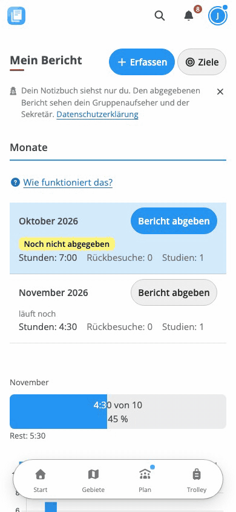
  &nbsp;
  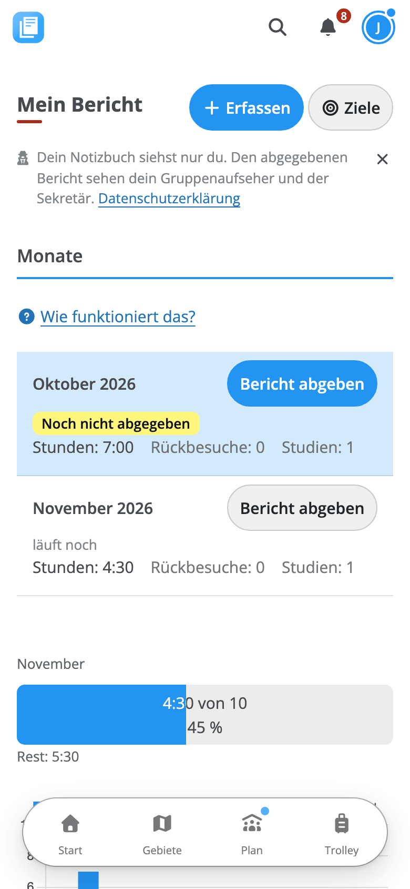
</p>

**Gruppenaufseher und Gehilfe**

- Sehen, wer aus der Gruppe noch fehlt — auch als Zahl auf der Kachel.
- Erinnern mit einem Klick, Meldungen auf Papier oder per Telefon im Dialog nachtragen, die Gruppe
  als Excel laden.

<p align="center">
  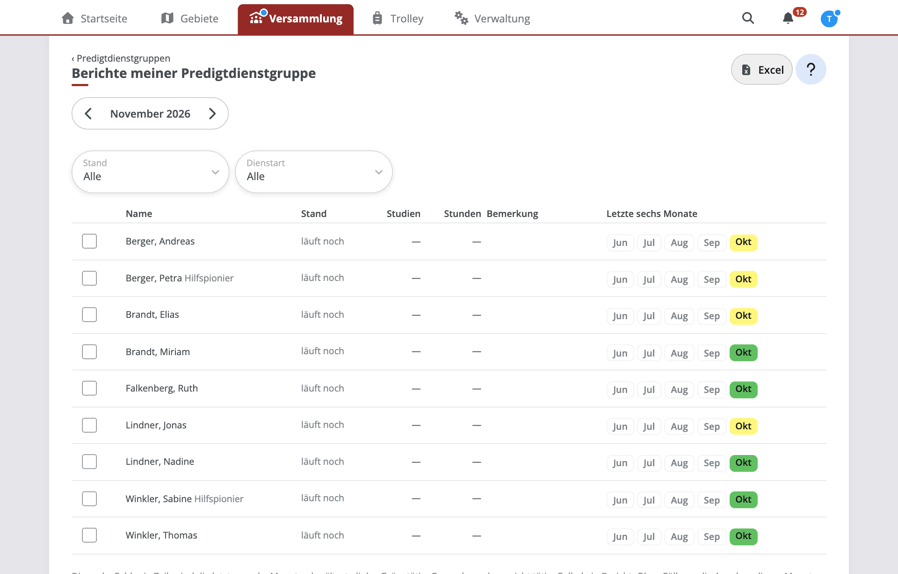
</p>

**Sekretär**

- Sieht die ganze Versammlung nach Gruppen: offene Berichte, Gruppen ohne Aufseher, Personen ohne
  Gruppe — mit Suche nach Namen.
- Bekommt die Zahlen für jw.org in der Reihenfolge des Formulars, markiert sie als eingegeben und
  erfährt von späteren Änderungen.
- Pioniere werden einmal mit Beginn und Ende eingetragen. Vormonate lassen sich im ersten halben
  Jahr nachtragen.
- Selbstabgabe an oder aus: entweder trägt jeder selbst ein, oder Gruppenaufseher und Sekretär.

**Datenschutz eingebaut**

- Zahlen und Bemerkung liegen verschlüsselt in der Datenbank.
- Nichts wird aufbewahrt: Stunden, Studien und Bemerkung sind nach drei Monaten gelöscht, der Rest
  nach acht.
- Die App bewertet niemanden — kein „regelmäßig“ oder „untätig“, nur die letzten sechs Monate als
  Kästchen.

### 🏛️ Rund um den Saal

**Reinigung und Müllkalender**

- Haupt-, Zwischen- und Übergabereinigung für alle Gruppen geplant.
- Die Leerungen des Entsorgers stehen im Reinigungskalender; um 18 Uhr sagt ein Push, welche Tonnen
  raus- oder reinmüssen.

**Instandhaltung**

- Pro Monat plant das Komitee eine oder zwei Gruppen mit Zieltag; das Jahr gibt es als PDF.
- Arbeitsblätter werden im Auftrag als Checkliste abgehakt. Jedes Blatt kennt seine Historie.
- Erledigt? Aufseher und Gehilfe der Gruppe melden es mit einem Tipp.

<p align="center">
  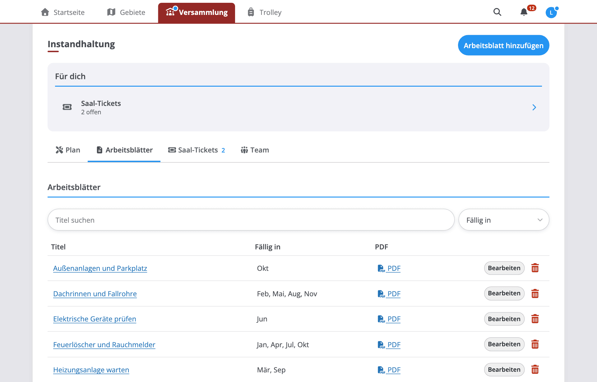
</p>

**Saal-Tickets**

- Mängel am Saal meldet jeder mit Foto oder Text; die Instandhaltung antwortet im Gespräch.
- Ein QR-Code als Aushang im Saal führt direkt zur Meldung.

**Raumbelegung und geteilter Saal**

- Wer welchen Raum wann belegt; wiederkehrende Termine buchen den Raum gleich mit.
- Versammlungen, die sich einen Saal teilen, treten einer Versammlungs-Gruppe bei und stellen
  Reinigungspläne, Treffpunkte, Teams und allgemeine Termine versammlungsübergreifend bereit.

<p align="center">
  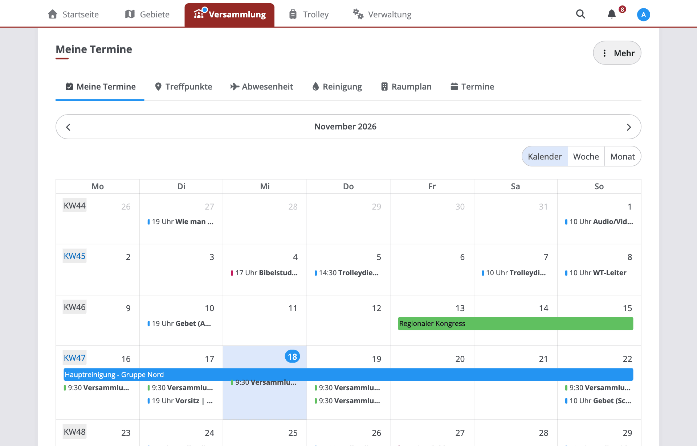
</p>

### 📣 Kommunikation

**Aushang**

- Das schwarze Brett der Versammlung, digital: Plakate zum Wischen, Neues ist markiert. Ausdrucke
  direkt aus dem Seitenkopf.

**Eilmeldungen**

- Eine Info an alle oder eine bestimmte Personengruppe — als Nachricht, die man nicht übersieht.

**Mitteilungen und Gespräche**

- Push und E-Mail, beides im eigenen Profil einstellbar. Benachrichtigt wird nur, wen es betrifft.
- Mitteilungen wie Mail: wischen zum Archivieren, ungelesene mit Punkt. Ersatzanfragen und Tickets
  stehen gesammelt unter „Gespräche“ und lassen sich dort direkt beantworten.

### 🧭 Versammlung einrichten und organisieren

**Ersteinrichtung als Assistent**

- Schritt für Schritt durch Datenschutz-Kontakt, Bereiche, Helfer und Zugänge. Danach zeigt die App,
  was noch offen ist.
- Personen und Predigtdienstgruppen aus einer Tabelle einlesen — mit Excel-Vorlage.

**Leute ins Boot holen**

- Eine Einladung auf einem Zettel: ein QR-Code, der einmal gilt.
- Oder ein **Beitrittslink**: Personen legen sich selbst ein Konto an, der Verwalter gibt jedes frei
  oder verwirft es.

**Aufgaben verteilen**

- Eine Seite für die ganze Versammlung: Älteste, Dienstamtgehilfen, Koordinator, Sekretär,
  Gebietsdiener, Teams für Trolley und Instandhaltung.
- Was jemand sehen und tun darf, folgt allein aus Status und Aufgaben. „So funktioniert“ erklärt je
  Bereich, wer was darf.

<p align="center">
  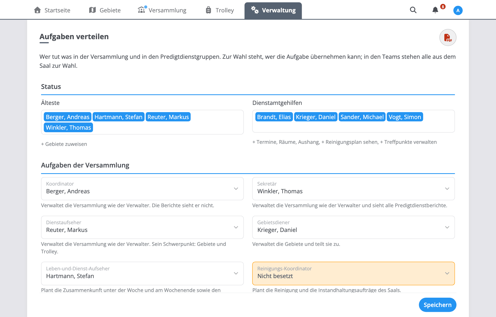
</p>

### 📱 Eine Oberfläche für Handy und Rechner

**Startseite nach Wunsch**

- Beim ersten Besuch „Einfach“ oder „Erweitert“ wählen — die Favoriten stellen sich passend zusammen.
- Favoriten in drei Größen, Blöcke gedrückt halten und verschieben, Begrüßung und Suche ausblenden.

**Lesbar auf jedem Gerät**

- Am Handy werden Tabellen zu Listen; wer alle Spalten will, schaltet sie ein.
- Hell, dunkel oder wie das System; Schriftgröße einstellbar.
- Die Oberfläche spricht fünf Sprachen, darunter Deutsch, Englisch, Griechisch und Russisch.

### 📶 Unterwegs und offline

Im Gebiet, im Keller, auf dem Land — kein Empfang ist kein Problem.

**Als App installiert**

- VAPP kommt als WebApp auf den Home-Bildschirm. Kein App-Store, kein Konto bei irgendwem.

**Stammseiten laden von selbst**

- Beim Öffnen der Startseite kommen Startseite, eigene Gebiete, aktueller Plan, Trolley-Plan und
  Kalender aufs Gerät — höchstens alle vier Stunden, auf Wunsch nur im WLAN.
- Abschalten geht im Profil unter „Geräte“.

**Für unterwegs laden**

- Ein Knopf im Profil unter „Geräte“ lädt alles auf einmal: Pläne samt nächster Periode, Termine
  für diesen und den nächsten Monat, die eigenen Gebiete mit Bild, QR-Code und Karte.
- Die Gebietskarte zeigt offline die zuletzt gesehenen Ausschnitte.

**Immer klar, was aktuell ist**

- Jede Seite aus dem Speicher trägt oben „Offline — geladen am …“. Die Startseite zeigt, wann
  zuletzt geladen wurde und ob Seiten fehlen.

### 🔐 Eigener Betrieb, eigene Daten

**Selbst gehostet**

- Die Anwendung läuft bei dir auf einem Rechner, bei einem Bruder der Versammlung oder einem
  beliebigen Server. Es gibt keinen kostenpflichtigen Dienst dazwischen, der mitliest, und keine
  Rechnung.

**Anmeldung mit Passkey**

- Fingerabdruck, Gesicht oder Geräte-PIN statt Passwort.

**Sicherung per Knopfdruck**

- Unter System → Sicherung lädt der Betreiber die ganze Anlage als verschlüsselte Datei herunter;
  `restore.sh` spielt sie auf einer neuen Anlage ein.
- **Notfallzugang:** Eine weitere Person darf nur diese Sicherung laden — für den Tag, an dem der
  Betreiber nicht erreichbar ist.

**Datenschutz ab Werk**

- Datenschutzerklärung und AVV liegen bei, kurze Löschfristen sind eingebaut. Jeder lädt seine
  eigenen Daten als Auskunft herunter.

## Die Technik - was gebraucht wird

- **Linux-Rechner mit Docker** und Compose-Plugin. Sowohl x86-64 als auch arm64 werden unterstützt.
- Eine eigene **Domain**, die auf diesen Rechner zeigt.
- Ein **TLS-Zertifikat**. VAPP bringt einen Reverse Proxy mit und holt es selbst bei Let's Encrypt —
  wer schon nginx oder Traefik davor hat, hängt es dahinter.
- Ein **SMTP-Zugang** zum Versenden der Mails aus der VAPP.
- Etwa **zwanzig Minuten** für die Ersteinrichtung.

> **Hinweis:**
>
> **Eine IP-Adresse genügt nicht.** Passkeys verlangen eine Domain und eine gesicherte
> Verbindung — der Browser führt die Anmeldung sonst gar nicht erst aus.
>
> **Ohne SMTP keine Einladungen.** VAPP läuft, aber es kann niemanden per Mail einladen und kein
> Passwort zurücksetzen — auch nicht das eigene.

## Loslegen

Alles, was zum Betrieb gehört — Compose-Datei, Einrichtungs-, Start-, Backup- und
Restorescript und die vollständige Anleitung — steckt **im Image**.

```bash
mkdir -p ~/vapp && cd ~/vapp
docker run --rm ghcr.io/rbnet-apps/vapp-app:latest tar -C /opt/vapp-bundle -cf - . | tar -xf -
./setup.sh
./start.sh
```

Danach im Browser **`https://<domain>/commissioning`** aufrufen und das Betreiberkonto anlegen.

> ⚠️ **Ein Schlüssel muss aufbewahrt werden.** `NOTES_ENCRYPTION_KEY` verschlüsselt die Notizen in der
> Datenbank. Eine Sicherung, die ohne ihn zurückgespielt wird, hat Notizen, die niemand mehr lesen
> kann — nicht die Versammlung, nicht der Verfasser, niemand. `setup.sh` sagt das in dem Augenblick,
> in dem es ihn erzeugt.

**Die ganze Anleitung ist [SELFHOST.md](SELFHOST.md)** — die fünf Schritte, die Sicherungen, was zu
tun ist, wenn Probleme auftreten.

### App aktualisieren

```bash
./start.sh --update
```

### Demo-Daten anlegen

Wer erst schauen will, legt eine erfundene Versammlung mit Personen, Plänen, Gebieten und Tickets an
— dieselbe wie in der [Live-Demo](https://demo.rbnet.me):

```bash
docker compose exec php bin/console app:demo:seed
```

Steht sie schon, fragt der Befehl, ob er ihr Zeitfenster auf heute verschieben soll.

### Demo-Daten entfernen

```bash
docker compose exec php bin/console app:demo:remove
```

## Die Images

| Image                         | Was darin ist                                                                 |
| ----------------------------- | ----------------------------------------------------------------------------- |
| `ghcr.io/rbnet-apps/vapp-app` | die Anwendung — PHP-FPM, die Konsole und die Dateien unter `/opt/vapp-bundle` |
| `ghcr.io/rbnet-apps/vapp-web` | nginx davor, mit der gebauten UI                                              |

Beide für **`linux/amd64` und `linux/arm64`** — ein gemieteter x86-Server und ein Raspberry Pi laufen
gleich gut. `latest` ist die aktuelle Fassung; daneben hat jeder Build einen eigenen Commit Hash, über den man die Version festsetzen kann. MySQL und Redis sind nicht in diesen Images — sie kommen aus der Compose-Datei im Paket.

## Womit es gebaut ist

| Schicht          | Was                                                              |
| ---------------- | ---------------------------------------------------------------- |
| Anwendung        | Symfony 8.1, PHP 8.5, Doctrine ORM 3                             |
| Oberfläche       | Twig serverseitig, TypeScript, SCSS, Bootstrap 5.3               |
| Auslieferung     | PWA — installierbar, Service Worker, Web Push. Keine native App. |
| Datenbank        | MySQL 8.4                                                        |
| Zwischenspeicher | Redis, Symfony Messenger                                         |
| PDF              | Gotenberg (Chromium)                                             |

## Lizenz

VAPP ist **source-available**, nicht Open Source: [PolyForm Noncommercial 1.0.0](LICENSE) mit einem
Zusatz. Kurz gesagt —

- **Benutzen, verändern, weitergeben** ist erlaubt. Die Grenze liegt beim **Einsatz**, nicht beim
  Kopieren.
- **Nicht kommerziell** — aber die **eigenen Kosten zu decken**, wenn man für andere Versammlungen
  hostet, ist ausdrücklich erlaubt. Das ist der Hauptfall und steht in der Lizenz.
- **Weiterverkaufen, unterlizenzieren oder ein gewinnorientiertes Dienstangebot** daraus machen:
  nicht erlaubt.

Die Nutzungsgrenze schließt ein Einsatzgebiet aus, darum ist die Lizenz nicht OSI-anerkannt und
GitHub zeigt „Other". Das ist bei PolyForm normal, und **source-available** ist das zutreffende Wort.

## Quelltext

Der Quelltext ist **noch nicht veröffentlicht** — vorerst gibt es nur die Images, das Repository
folgt. Bis dahin werden hier die Lizenz und die Anleitung bereitgestellt.

## Ein Sicherheitsproblem gefunden?

**Bitte kein öffentliches Issue.** Der Knopf _Report a vulnerability_ im Reiter _Security_ dieses
Repositorys öffnet eine Meldung, die nur der Betreuer lesen kann. Wer ihn nicht sieht, schreibt an
die Adresse aus der Zeile `Required Notice:` der [LICENSE](LICENSE), Betreff `vapp security`.
Einzelheiten in [SECURITY.md](SECURITY.md).

---

<div align="center">

VAPP wird von Brüdern in ihrer Freizeit entwickelt.
Es ist kein offizielles Werkzeug der Organisation und steht in keiner Verbindung zu Jehovas Zeugen
oder der Watch Tower Bible and Tract Society. Alle genannten Produktnamen gehören ihren Inhabern.

</div>
